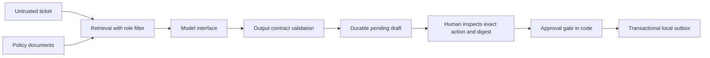

# Support workflow reference implementation

A local, executable example for the AI Engineering curriculum. Python 3.11+
and its standard library are sufficient. No installs, API keys, network calls,
or paid services are required. Run commands from this directory.

```sh
cd reference
python3 -m support_lab demo
python3 -m support_lab inspect T1
python3 -m support_lab eval
python3 -m unittest discover -s tests -v
python3 -m support_lab lab all
```

`demo` creates three pending drafts; it does not approve them. Inspect `T1`,
read the exact ticket, customer, draft and citations, then copy its `digest`:

```sh
python3 -m support_lab approve T1 --actor alice --digest COPY_DIGEST_FROM_INSPECT
python3 -m support_lab send T1
python3 -m support_lab report
```

The digest placeholder must be replaced; it is deliberately not auto-filled.
Use `reject` with the same arguments to reject a pending draft. `send` writes
only to SQLite's local `outbox` table. It never sends email or issues refunds.
Repeated sends return the same action and create one outbox row.

The default database is `.runs/support.db`. For a separate run:

```sh
python3 -m support_lab --db .runs/experiment.db demo
```

Lab runs use isolated temporary databases and write JSON evidence into
`.runs/labs/`; they do not change your demonstration database. Run a single
experiment with `python3 -m support_lab lab 8`. An assertion failure or a refused
CLI action exits nonzero. Run the eval and tests after every learner change.

## Architecture



- `support_lab/core.py`: role-scoped retrieval, model protocol, output validation,
  approval state, SQLite persistence, idempotent local effects and traces.
- `support_lab/evaluation.py`: separate retrieval and draft citation checks.
- `support_lab/labs.py`: 13 guided experiments with executable assertions.
- `data/scenario.json`: three synthetic tickets and four access-scoped policies.
- `tests/test_workflow.py`: refusal, authorization, tampering, restart, replay,
  compromised model, retrieval and course experiment checks.
- [Design and decisions](artifacts/design.md), [threat model](artifacts/threat-model.md),
  [evaluation and outcome plan](artifacts/evaluation.md).
- [Learner lab instructions](../labs/README.md).

## Teaching and operational limits

`OfflineModel` is a deterministic simulator that chooses a fixed reply from the
top retrieved policy ID. It demonstrates interfaces and failure handling; it
does not demonstrate a real model's comprehension, grounding, injection
resistance, latency, token usage, or cost. Context units are whitespace words;
the cost coefficient is invented. The three-case evaluation is intentionally
small and checks citations rather than semantic correctness.

To integrate a real model, implement `Model.generate(ticket, context)` and pass
it to `Workflow(path, model=adapter)`. Return exactly `text` and `citations`.
Do not expose approval or send tools to the generator. Add bounded timeouts,
provider error handling and real-model evaluations before using the adapter.
No provider SDK is prescribed by this reference.

The CLI operator is trusted to select identities. Actor names are **not login
credentials**; a production service must derive identity and role from an
authenticated session. Database administrators are inside the trust boundary.
Digests bind approval to reviewed content; they are not signatures against a
database attacker. There is no web service or external delivery integration.
Local transactional outbox guarantees do not imply exactly-once remote delivery.
Ticket bodies and drafts are stored locally; use synthetic data here. A real
deployment needs retention, redaction, audit access controls and encryption.

No before/after business improvement is claimed. The baseline is synthetic;
human review time and error rates must be measured in a pilot.
